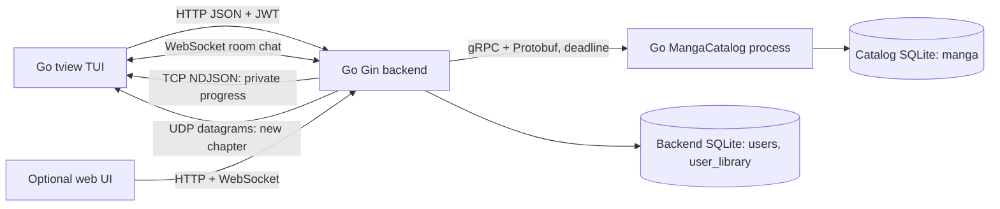
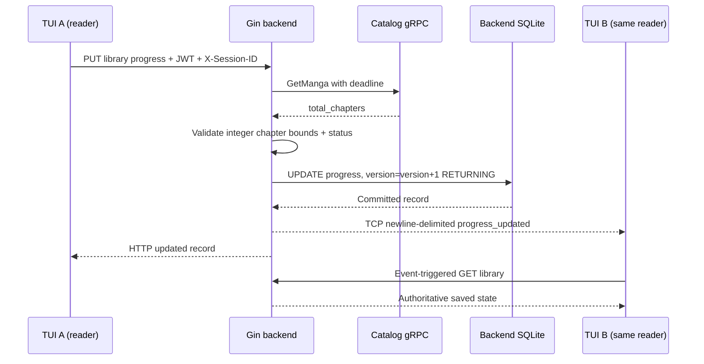
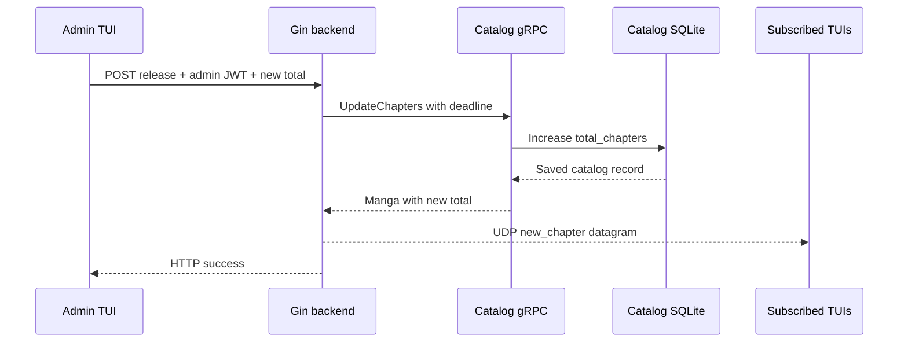

# MangaHub architecture

The required application has three independent Go processes. The browser is an
additional client; the assessed five-protocol workflows run through the tview TUI.

## Ownership and boundaries

- `cmd/backend`: accounts, hashed passwords, JWT validation, personal libraries,
  versioned reading progress, protected chapter-release endpoint, TCP/UDP hubs,
  and room-isolated Gorilla WebSocket hub.
- `cmd/catalog`: `SearchManga`, `GetManga`, `UpdateChapters` RPCs and manga SQLite.
  Only this process accesses catalog metadata during normal operation. It binds
  to loopback because its update RPC has no external transport authentication.
- `cmd/tui`: renders controls, performs HTTP requests off the event loop, receives
  TCP/UDP/WebSocket traffic and updates widgets via `QueueUpdateDraw`.
- `cmd/catalog-refresh`: explicit offline metadata migration tool; it is not a
  substitute for the separate runtime catalog service.

The Go module is `github.com/Anh2603/MangaHub`. Only MangaHub HTTP handlers,
RPCs and TUI screens are compiled. Backend startup creates users and libraries;
catalog startup creates manga metadata. Existing databases are upgraded without
dropping tables. The persisted `learner` role is retained for account compatibility
and displayed as Reader. JWT issuer and WebSocket subprotocol are `mangahub`;
browser session storage uses `mangahub.session`. Upgrading requires a fresh login.

## Progress update flow

The backend serializes progress commit plus event enqueue to preserve server
version order. The TCP hub routes only to other sessions of the verified user.
The TUI applies backpressure instead of dropping parsed progress events. Multiple
events coalesce into a bounded library refresh. If TCP breaks, exponential-backoff
reconnection triggers a fresh library read, recovering state missed while offline.
This is event-driven recovery, not periodic HTTP polling.

## Chapter release flow

UDP subscribers authenticate, unsubscribe explicitly, and expire unless renewed.
Datagrams are best-effort. A missing receiver does not roll back the saved release.

## Failure behavior and limits

HTTP input errors use controlled status codes. Catalog calls have deadlines;
catalog downtime maps to HTTP 503. TCP uses one JSON object per newline and a
bounded server queue. Slow or broken clients are disconnected without blocking
other readers. WebSocket rooms use server-controlled membership and one writer
per socket. Chat history is not persisted. Redis is not implemented (optional).

Keep the same JWT secret across backend restarts to resume existing sessions.
Changing the secret intentionally invalidates those sessions and requires login.
